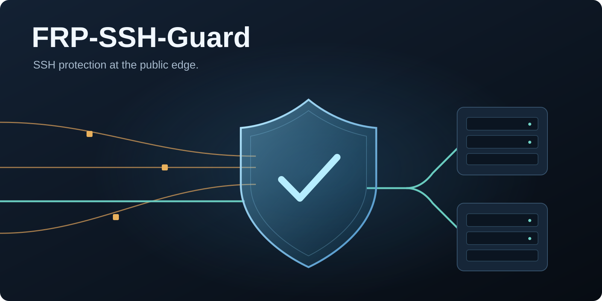
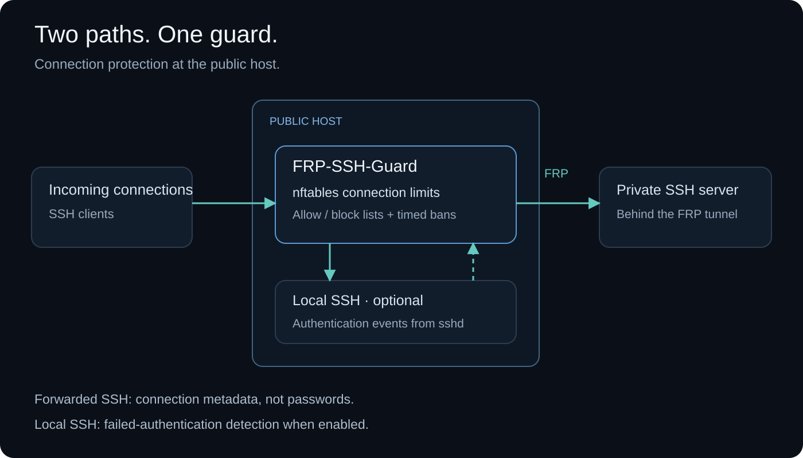

# FRP-SSH-Guard

**English** | [简体中文](README.zh-CN.md)



**[Download v0.0.7 .deb](https://github.com/xybermindx/FRP-SSH-Guard/releases/download/v0.0.7/frp-ssh-guard_0.0.7.deb)** · [All release files](https://github.com/xybermindx/FRP-SSH-Guard/releases/tag/v0.0.7)

Protect FRP-forwarded SSH ports and, optionally, the public server's own SSH port 22.
FRP-SSH-Guard uses nftables connection limits, local SSH failure detection, shared
or per-port jails, and scoped or timed manual blocks. Install on the public
`frps` host; configuration lives in `~/.frp-ssh-guard/` and upgrades preserve
custom values and active protection. Local SSH protection and per-port jails
default to off; slow brute-force protection defaults to on.

> **Observed impact (~10-day window):** **4,255,592** abusive packets dropped
> (**99.97%**), **1,110** auto-bans across **595** unique IPs, and **0** backend
> failed logins in the latest 24-hour window.

**Version 0.0.7 · MIT licensed · Bash and Python**

[What's new in v0.0.7](docs/RELEASE-v0.0.7.md) ·
[Configuration and command examples](docs/EXAMPLES.md) ·
[Upgrade instructions](docs/MIGRATING.md)

[Deployment](#deploy-step-by-step) · [Configuration](#configuration) ·
[Commands](#commands) · [Attack coverage](#what-it-protects-against) ·
[Verification](#verify-that-protection-takes-effect) · [Build from source](#open-source-and-building)

## Protection paths



Forwarded SSH authentication stays encrypted; the guard uses connection metadata. Optional local SSH protection reads the public host’s sshd authentication events. Passwords are never collected.

## Observed deployment results

An operator-reported dataset from a live deployment during a **~10-day observation window**, together with a **~30-day backend log window**.

| Metric | Before / earlier (reported) | With the guard (reported) |
| --- | --- | --- |
| Observation window | - | **~10 days** |
| Auto-ban events recorded | - | **1,110** |
| Unique IPs auto-banned | - | **595** |
| Auto-ban events per day | - | **155 to 37** across the window |
| Guard packet counters, ~5 days since last reload | - | **4,255,592 dropped; 1,287 passed** |
| Drop fraction of those packet counters | - | **99.97%** |
| Backend failed logins, 24-hour window | **6,442** | **0 observed** |
| Backend failed logins, ~30 days before the public guard | **927,446** | - |
| All-proxy connections, hourly | Approximately 248/hour | **~56/hour** (1,336 in 24 h) |
| SSH connections reaching backends, 24 hours | Approximately 200+/hour | **246 (~10/hour)** |

Against the reported baseline this is roughly **77% fewer all-proxy connections**
and **95% fewer SSH connections reaching the backends**, while the backend
recorded **zero failed logins** in the latest 24-hour window. The remaining
all-proxy traffic was mostly public web traffic on port 443, which this
deployment intentionally left outside the guarded ports.

The packet figure is `4,255,592 / (4,255,592 + 1,287)`. It describes the supplied
counters; established and allowlisted traffic can bypass those counters. It does
not measure unique attackers or attack-prevention accuracy. Zero recorded failed
logins means none were observed in that 24-hour window; successful logins and
other authentication activity are separate metrics.

The 1,110 ban events and 595 unique addresses are cumulative for the ~10-day
observation window; the packet counters cover the ~5 days since the rules were
last reloaded. Both are raw observations, not normalized rates.

These are observations from an existing deployment, supplied by its operator;
the exact deployed version and raw logs were not supplied for independent
verification. Traffic, settings, and logging coverage affect results. The operator
also reported CPU usage displaying approximately 0% and a few MB of process RAM;
the measurement method and kernel firewall costs were not provided, so these
resource figures are not a performance benchmark.

## Purpose and features

FRP exposes private services through a public server. Forwarded SSH ports can
attract automated probes and repeated connection attempts. This project adds a
host firewall policy specifically for the ports you choose:

- Per-source, per-port new-connection rate limits and temporary source bans.
- Slow brute-force protection: long-window connection limits on forwarded ports and
  a long-window failed-login limit on this server's port 22. Whitelisted sources are never counted.
- Optional protection of this server's port 22, including local sshd authentication failures.
- Shared IP jails by default, or separate jails per port.
- A shared per-port rate limit to reduce distributed connection bursts.
- IPv4/IPv6 IP and CIDR allow/block lists, optionally restricted to selected ports.
- Ban history and longer bans for repeatedly observed offenders.
- Automatic administrator learning: after a successful login to the public host's sshd
  by root, the settings owner or a sudo/admin/wheel member, that source is whitelisted.
- Explicit configuration activation, reboot restoration, and recovery of a missing guard table.
- An architecture-independent Debian package, complete source, and reproducible builds.

The guard observes new TCP SYN packets. It **cannot see passwords or login results
inside forwarded SSH sessions**. It complements authentication controls; it is not
an intrusion detection system or an upstream DDoS service.

## Where to deploy


Install on the **public `frps` host**, where the public forwarded ports listen.
Installing only on the private `frpc` host does not protect the public listeners.
For example, if public port `22001` forwards to a private machine's port `22`,
protect `22001` on the public server.

Target environment:

- Debian 12+ or Ubuntu 24.04+, systemd, nftables 1.0.6+, and kernel nftables support.
- Root access for installation and firewall changes.
- `frps` listening directly in the host network namespace. Container bridge/NAT
  port publishing is not covered by this input-hook design; validate that topology separately.
- One guard instance per host. Existing firewall rules still apply; the guard does
  not open a port blocked by another firewall.

Only selected TCP ports are filtered. Keep FRP control and public web ports out of
the selection. Enable management SSH on port 22 separately with
`PROTECT_SERVER_SSH=on`; it defaults to `off`. Other selected listeners must be
`frps`. The validator cannot determine which application an FRP tunnel carries.

These are target platforms, not a claim that every kernel/distribution combination
has been tested. See [validation results](docs/VALIDATION.md).

## What it protects against

| Traffic or attack | Expected effect and limits |
| --- | --- |
| Many new connections from one source to one protected port | Exceeding the per-source limit adds a temporary ban; shared across protected ports by default, or per port when enabled. |
| SSH brute-force tools that repeatedly reconnect | Limits connections; optional local sshd monitoring also counts authentication failures on this server. |
| Repeated local SSH invalid-user attempts | With port-22 protection on: ban after 3 distinct invalid-user connections or 5 failures within 10 minutes by default. |
| Distributed connection bursts | The shared per-port limit drops excess new attempts; legitimate traffic can also be affected. |
| Repeated observed bans | Strike escalation can impose longer bans; sampling can miss short or repeated events. |
| Known unwanted IPs/networks | Manual blocks drop matching traffic to guarded ports, subject to whitelist and established-connection precedence. |
| Slow attempts that stay under the per-minute limits | With `SSH_SLOW_PROTECTION=on` (default): banned after more than 300 new connections per source across forwarded ports in 24 hours (100 on one port with per-port jails), or 20 failed logins on local port 22. Counts refill gradually, so they are approximate. |
| Password guesses inside a forwarded SSH connection | Not visible; forwarded authentication outcomes are unavailable, so only connection counts apply. |
| Application exploits or stolen credentials | No application-level detection or prevention. |
| Bandwidth-saturating DDoS | No availability guarantee; host filtering cannot recover an already saturated upstream link. |
| Unconfigured ports, UDP, and other protocols | Outside the filtering scope. |

**Effectiveness depends on traffic, limits, and the deployment.** The observed
results above are specific to one deployment. No general prevention percentage,
throughput benchmark, or external security audit is claimed. New SYN
packets, including retransmissions, are measured—not exact sessions or login attempts.

## Download a release

Download from **[GitHub Releases](https://github.com/xybermindx/FRP-SSH-Guard/releases/tag/v0.0.7)**. Debian `.deb` files are
release assets; they do not appear in the GitHub **Packages** tab.
Release v0.0.7 contains:

| Artifact | Purpose |
| --- | --- |
| [frp-ssh-guard_0.0.7.deb](https://github.com/xybermindx/FRP-SSH-Guard/releases/download/v0.0.7/frp-ssh-guard_0.0.7.deb) | Install on the target Debian/Ubuntu host. |
| [SHA256SUMS](https://github.com/xybermindx/FRP-SSH-Guard/releases/download/v0.0.7/SHA256SUMS) | Verify the downloaded Debian package. |

The complete source remains in the repository. GitHub automatically provides
[Source code (zip)](https://github.com/xybermindx/FRP-SSH-Guard/archive/refs/tags/v0.0.7.zip)
and [Source code (tar.gz)](https://github.com/xybermindx/FRP-SSH-Guard/archive/refs/tags/v0.0.7.tar.gz)
for the release tag, including the runtime, build scripts, packaging, docs, and tests.
Separate source bundles are not uploaded as release assets. `SHA256SUMS` covers the `.deb`.

The package contains scripts rather than a CPU-specific compiled binary. Its
Debian metadata uses `Architecture: all`; dependencies are installed for the host
architecture. CI currently validates x64 (amd64); ARM and 32-bit systems have not
been verified. Checksums detect corruption/changes; they are not publisher signatures.
FRP/systemd behavior has been checked in a disposable Debian 12 VM. The
[CI workflow](https://github.com/xybermindx/FRP-SSH-Guard/actions/workflows/ci.yml)
checks builds, nftables and Debian/Ubuntu package lifecycles. See
[validation results](docs/VALIDATION.md) for the tested scope and limitations.

## Deploy step by step

### 1. Start the intended FRP listeners

On the public server, start `frps` and connect the appropriate `frpc` clients.
For an example forwarded SSH port:

```bash
sudo ss -lntp 'sport = :22001'
```

The listener must identify as `frps`. Validation requires at least one selected
active FRP listener; selected unused ports are allowed, but selected non-FRP
listeners are rejected. Make sure the forwarded SSH service already works.
If protecting only this server's SSH, `PROTECT_SERVER_SSH=on` allows an empty
FRP selection and validates the port-22 sshd/systemd socket listener instead.

### 2. Verify and install the package

Download the `.deb` and `SHA256SUMS` into the same directory:

```bash
sha256sum --ignore-missing -c SHA256SUMS
sudo apt install ./frp-ssh-guard_0.0.7.deb
```

Confirm the `.deb` reports `OK`. **Upgrading an active guard automatically applies
the updated rules and monitors; no manual reload is needed.** A fresh or disabled
installation stays inactive until ports are configured and protection is enabled.
Dependencies are resolved through apt.

### 3. Configure your public forwarded ports

```bash
${EDITOR:-nano} ~/.frp-ssh-guard/settings.conf
```

Installation automatically creates this folder and migrates existing settings
and manual lists. A normal `sudo apt install ./frp-ssh-guard_0.0.7.deb` uses the
invoking user's home. Direct root/unattended installation uses
`/root/.frp-ssh-guard/`. Later upgrades keep the previously selected owner and
customized values, even when another administrator installs the package.

Starting with package `0.0.5-2`, installation also adds missing settings and their
comments from the current template. Missing `PROTECT_SERVER_SSH=off` and
`JAIL_PER_PORT=off` switches are inserted immediately below `PROTECTED_PORTS` and
`EXCLUDE_PORTS`, before other settings. Existing assignments and comments stay
intact, including switches already set to `on`. Before changing a file, the
installer saves an exact private copy beside it as `settings.conf.before-upgrade-*`
(mode 0600). Reinstalling a complete config makes no changes or extra backups.
Other missing defaults are appended; a missing `PROTECTED_PORTS` is never filled
with an empty value that would override a legacy port list.

This updates the editable file only. Accepted policy, active bans and timer
deadlines stay unchanged; pending custom edits remain unapplied. Status can show
pending edits after defaults are added. Set `PROTECT_SERVER_SSH=on` and explicitly
run `check` then `reload` when ready to activate local SSH protection. An unavailable
or invalid file is left alone with a notice; fix it and reinstall using
`sudo apt install --reinstall ./frp-ssh-guard_0.0.7.deb` to retry.

To choose an owner before the first migration, use
`sudo env FRP_GUARD_CONFIG_USER=USERNAME apt install ./frp-ssh-guard_0.0.7.deb`.
Conflicting existing home files or an unavailable home leave the old configuration
in use; the installer reports this instead of overwriting data. Use
`frp-ssh-guard --help` to see the actual settings path and `sudo frp-ssh-guard
config-home USERNAME` to retry. Migration preserves accepted policy, jails and
timer deadlines; an active list watcher switches over without a systemd reload.

For public ports `22001`, `22003`, and `23000–23010` except `23005`:

```bash
PROTECTED_PORTS="22001,22003,23000-23010"
EXCLUDE_PORTS="23005"
PROTECT_SERVER_SSH=off
JAIL_PER_PORT=off
PER_IP_RATE=2
PER_IP_BURST=40
GLOBAL_RATE=30
GLOBAL_BURST=20
BAN_TIMEOUT=6h
LEARN_ADMINS=on
LOGIN_USERS=""
```

These are examples: replace the ports with your actual forwarded SSH ports.
The shipped file leaves `PROTECTED_PORTS` empty, so activation requires your choice.
Keep the other defaults initially; shared NAT/VPN usage may require tuning.

### 4. Validate and activate

```bash
sudo frp-ssh-guard check
sudo frp-ssh-guard enable
sudo frp-ssh-guard status
```

`check` validates without activating. `enable` applies protection immediately and
enables restoration after reboot. Open another SSH connection to verify access;
keep an existing management session or console available during testing.

An optional first-install trial automatically expires after 30 minutes:

```bash
sudo frp-ssh-guard trial
# Test access from another connection, then retain protection:
sudo frp-ssh-guard keep
```

Use `trial` instead of `enable`, while the guard is inactive and disabled. A trial
is not restored after reboot; `keep` enables persistent startup. Finish a pending
trial with `keep` or `disable` before changing policy.

### 5. Change settings later

```bash
${EDITOR:-nano} ~/.frp-ssh-guard/settings.conf
sudo frp-ssh-guard check
sudo frp-ssh-guard reload
sudo frp-ssh-guard status
```

Saving alone does not apply settings. Background jobs, manual-list updates, table
recovery, and reboot use the last accepted policy. `check` validates without
changing anything. `reload` accepts the edits and applies them while the guard
runs; use `enable` instead the first time or after `disable`. `status` then shows
`Pending edits: no`. Reload keeps current bans and learned entries with their
remaining time; connection counters start again. `reload` also refreshes the
monitoring services. `whitelist.conf` and `blocklist.conf` are different: saving
them applies them automatically, with no reload. Validation or nftables application failure
keeps previous protection. Service/helper failures are reported separately; rules
may already be active when such an error is reported.

### Enable protection for this server's SSH port 22

Use `frp-ssh-guard --help` to find the actual settings path. Set the switch beside
the port selection to `PROTECT_SERVER_SSH=on`. Keep `JAIL_PER_PORT=off` for shared
bans, or set it to `on` for separate jails on each protected port. Saving alone
has no effect. For an already active guard:

```bash
sudo frp-ssh-guard check && sudo frp-ssh-guard reload
sudo frp-ssh-guard status
```

Confirm `Server SSH protection: on`. For first activation, use `enable` instead
of `reload`. The switch automatically includes port 22. An explicit reload
rebuilds the firewall and rate meters. Exported bans and learned entries retain
their original expiry. Package upgrades also refresh the rules automatically,
preserving saved ban deadlines and timer schedules.

Fail2ban can remain installed: the tools have separate rules and independent bans.
If both block an address, release it in both tools. The guard does not modify
Fail2ban jail settings; learning can add trusted addresses to an existing
Fail2ban sshd jail's ignore list. `LEARN_ADMINS=on` (the default) learns from
successful logins by root, the account that owns the settings folder, and members
of the `sudo`, `admin` or `wheel` groups; no usernames need to be typed in.
`LOGIN_USERS` adds other accounts by regex. `status` reports what is learned.
Password, public-key and keyboard-interactive/PAM successes are supported. Learned `[all]` entries cover
port 22 when protected; an entry under another port does not. Check Fail2ban
separately if an allowed source is still blocked.

See [examples](docs/EXAMPLES.md) for FRP-only, local-SSH-only and combined setups.

## Configuration

The complete [commented default](etc/settings.conf.example) explains each setting.
The file contains literal `KEY=value` assignments. It is parsed as data; shell
commands and substitutions are not executed. Configuration comments and CLI output
are English. Keep your home configuration private; it controls firewall policy.

| Setting | Default | Meaning |
| --- | --- | --- |
| `PROTECTED_PORTS` | Empty; required | Comma/space-separated ports or ranges. `22001:60:40` overrides that port's shared rate/burst. |
| `EXCLUDE_PORTS` | Empty | Ports/ranges omitted from the protected selection. |
| `PROTECT_SERVER_SSH` | `off` | `on` adds this server's port 22 and monitors local sshd outcomes. |
| `JAIL_PER_PORT` | `off` | `off`: new automatic bans cover all protected ports. `on`: new bans apply to the offending port. Existing scopes stay unchanged. |
| `SSH_SLOW_PROTECTION` | `on` | Slow brute-force switch, directly below `JAIL_PER_PORT`. `on` detects, logs and bans; `off` does none of these. Forwarded ports count new connections; port 22 counts failed logins when local SSH protection is on. Whitelisted sources (any port) are never counted. |
| `SSH_AUTH_FAILURES`, `SSH_INVALID_USER_FAILURES`, `SSH_AUTH_WINDOW` | `5`, `3`, `10m` | Local authentication failure threshold, distinct invalid-user connection threshold, and counting window. |
| `SSH_SLOW_TOTAL_CONNECTIONS`, `SSH_SLOW_PORT_CONNECTIONS`, `SSH_SLOW_FAILURES`, `SSH_SLOW_WINDOW` | `300`, `100`, `20`, `24h` | Slow limits: new connections per source across forwarded ports (shared jails) or on one forwarded port (per-port jails), failed logins on port 22, and their shared window. |
| `LOG_MAX_SIZE` | `10MiB` | Activity log size; newest first, oldest complete lines deleted; 1KiB–100MiB, no archives. Formerly `ALERT_LOG_MAX_SIZE`. |
| `SUBNET_REPORT_MIN_SOURCES`, `SUBNET_REPORT_WINDOW` | `5`, `24h` | Report distinct automatic sources per /24 or /64 and jail scope; never block a subnet automatically. |
| `PER_IP_RATE`, `PER_IP_BURST` | `2`, `40` | New SYN rate/minute and burst per source and port. |
| `GLOBAL_RATE`, `GLOBAL_BURST` | `30`, `20` | Shared new SYN rate/minute and burst per port, across sources and IP families. |
| `BAN_TIMEOUT` | `6h` | Temporary source-ban duration. |
| `LEARN_ADMINS` | `on` | Whitelist the source of a successful local login by root, the settings owner or a `sudo`/`admin`/`wheel` member for `LEARN_TIMEOUT`. Anyone sharing that public IP is trusted too. |
| `LOGIN_USERS` | Empty | Extra accounts that teach trust, as an extended regex, e.g. `alice|bob`. |
| `MAX_LEARNED`, `LEARN_TIMEOUT` | `500`, `90d` | Learned-source cap and time since the last trusted login. |
| `STRIKE_WINDOW` | `90d` | History window for observed ban events. |
| `STRIKE_LADDER` | `2:1d 3:3d 4:7d 5:28d` | Increasing strike thresholds and ban durations; empty disables escalation. |
| `STRIKE_MAX` | `28d` | Maximum escalation duration; saved deadlines are not renewed on restore. |
| `PORT_MIN`, `PORT_MAX` | `1`, `65535` | Inclusive validation bounds. |
| `EDIT_USER` | `root` | Trusted local account owning command-managed lists. |
| `GUARD_TABLE` | `frp_ssh_persistent_guard` | Dedicated nftables table; disable before changing its name. |

Changing `JAIL_PER_PORT` affects **new bans only**. Existing `[all]` bans remain
shared, and existing per-port bans retain their original ports in either mode.
No existing ban is released, broadened, narrowed or restarted by a mode switch.
Strike history keeps the scope recorded with each offense, so a later timer run
does not reinterpret old per-port offenses as shared ones. Manual scopes and
whitelist exceptions remain unchanged. After editing settings, run
`sudo frp-ssh-guard check && sudo frp-ssh-guard reload` to activate the change.

Durations use a positive integer followed by `s`, `m`, `h`, `d`, or `w`.
Rates, bursts, and the learned-source cap are integers from 1 to 1000000.
Burst allowances refill over time; they are not a fixed number of attempts per
calendar minute. Successful local-host login learning trusts source IPs and also
exempts them from an existing fail2ban `sshd` jail. It cannot learn successful
logins to SSH servers behind the FRP tunnel.

| Location | Purpose |
| --- | --- |
| `~/.frp-ssh-guard/settings.conf` | Editable policy, created/migrated automatically by installation. |
| `~/.frp-ssh-guard/whitelist.conf`, `blocklist.conf` | Combined manual/automatic lists, created/migrated automatically. |
| `/etc/frp-ssh-guard/` | Initial/legacy settings and the selected home location registry. |
| `/var/lib/frp-ssh-guard/applied.conf` | Generated accepted policy; do not edit. |
| `/var/lib/frp-ssh-guard/lists/` | Root caches, migration metadata and strike history; not additional user lists. |
| `/var/log/frp-ssh-guard/` | Ban and learning history. |
| `/usr/lib/frp-ssh-guard/` | Package-managed runtime programs. |

Manual and automatic entries share `whitelist.conf` and `blocklist.conf`.
Each file has instructions and `[all]` / per-port sections; see the
[list examples](docs/EXAMPLES.md#unified-lists). An address written **without a time is
permanent**, and `IP forever` means the same:

```ini
[all]
203.0.113.10                              # no time written: blocked forever
203.0.113.11 forever                      # the same, written out
198.51.100.0/24                           # a whole subnet, forever
203.0.113.12 tier=2                       # 1 day with the default ladder
203.0.113.15 until=2030-01-31T00:00:00Z   # until this UTC time
[22001]
203.0.113.20                              # forever, only on port 22001
```

Plain times such as `7d` are rejected in the file; use `tier=`/`until=`, or
`sudo frp-ssh-guard block IP --for 7d`. In the blocklist, `IP tier=1`
through `IP tier=5` select configured durations (defaults: 6h, 1d, 3d, 7d, 28d).
Automatic rows include `source=learned`, `source=runtime` or `source=strike` and
an absolute UTC `until=` expiry. Runtime includes automatic detection and the
`ban` command. Deleting an automatic row removes that ban/trust entry; a new
attack or trusted login may add it again. Use `unban` to also forgive strike history.

List saves are watched while active. Run `sudo frp-ssh-guard apply` to apply now;
it uses accepted settings and preserves active jail deadlines and rate meters.
Kernel bans appear after the log timer runs (normally within 60 seconds), or
immediately when `blocklist` refreshes the view. Avoid saving a stale editor
buffer over newer automatic entries. Installation imports existing jails and
legacy lists automatically; it retains legacy internal data for compatibility.
Root-owned accepted settings and cached lists allow startup when the user's home
is unavailable. Settings changes still require `check` and `reload`.
The guard continues to run as a system service; user login is not required.
The home directory is private (0700), and its files are private (0600). Select a
trusted administrator: that account can edit manual allow/block policy immediately.
Literal parsing prevents configuration from executing arbitrary shell commands,
but writable policy files still grant control over who the guard trusts or blocks.

Local SSH monitoring reads root-owned sshd journal records. It uses sshd's
invalid-user and failed/accepted authentication results; it never captures
passwords and discards usernames. A successful login clears recent failure counts.
The same ban timeout and jail scope apply to SYN and local authentication bans.
Loopback, established connections and allowed sources retain their precedence.
Authentication outcomes for SSH behind FRP remain unavailable. Monitoring requires
local sshd logs in journald and targets the server's standard port 22.

Manual blocks are permanent until `unblock` unless `--for` is specified. Scope
defaults to all **protected** ports; explicit scopes work in either jail mode:

```bash
sudo frp-ssh-guard block 198.51.100.20 --all
sudo frp-ssh-guard block 203.0.113.8 --ports 22001,22003 --for 6h
sudo frp-ssh-guard unblock 203.0.113.8
```

Timed entries store an absolute UTC `until=` timestamp, so reload/reboot does not
renew them. An all-port block follows the protected selection as it changes.
`ban IP [DURATION]` adds a timed runtime ban (default `BAN_TIMEOUT`) and saves
its expiry in the same blocklist. `block --for` creates a manually scoped timed entry.

## Commands

```bash
frp-ssh-guard --help                       # no root needed
frp-ssh-guard --version                    # version (also: version or -V)
sudo frp-ssh-guard check                    # validate edited configuration
sudo frp-ssh-guard enable                   # apply and enable reboot restoration
sudo frp-ssh-guard reload                   # accept edited settings while active
sudo frp-ssh-guard status                   # state, accepted ports, pending edits
sudo frp-ssh-guard ports                    # accepted port specifications
sudo frp-ssh-guard allow 198.51.100.10       # trust on all guarded ports
sudo frp-ssh-guard allow 2001:db8::10 22001  # trust only on one port
sudo frp-ssh-guard block 203.0.113.0/24 22001
sudo frp-ssh-guard banned
sudo frp-ssh-guard strikes
sudo frp-ssh-guard report
sudo frp-ssh-guard release 198.51.100.20     # remove blocks/bans and forgive history
sudo frp-ssh-guard disable                  # stop protection, retain settings/data
```

Addresses above are documentation examples, not real deployment entries.
`whitelist`, `blocklist`, `learned`, `unallow`, `unblock`, `unban`, `ban`, `remember`,
and `forget` provide additional administration. See `--help` for arguments.
`install`/`remove` remain aliases for `enable`/`disable`. `apply` reapplies accepted
policy and current lists; use `reload` to accept settings edits.

## Verify that protection takes effect

A successful activation should report the guard active and reboot restoration
enabled. `status` should show `enabled`, `active`, accepted ports, no pending edits,
and whether a trial is pending. These are **expected observations**, not benchmark results.

For reproducible checks on a disposable FRP deployment, including a bounded
connection-burst example, see [verification procedure and results](docs/VALIDATION.md).
Check normal access first, then excessive connection attempts, whitelist behavior,
releasing a ban, unchanged unprotected services, explicit reload, and reboot.
Inspect counters with:

```bash
sudo nft list table inet frp_ssh_persistent_guard
sudo frp-ssh-guard banned
sudo journalctl -u frp-ssh-guard.service -u frp-ssh-guard-learn.service --since '-10 min'
```

Operational limits:

- Sources behind shared NAT/VPN count together. Shared per-port limits can drop legitimate traffic during a flood.
- Existing established/related connections and loopback traffic bypass this guard. Whitelists precede blocks; they do not override unrelated firewall tables.
- Explicit `reload`, restart, reboot and automatic package refresh rebuild the table and reset rate meters. Exported bans and learned entries retain their deadlines. Upgrades snapshot live bans before replacement; an abrupt restart can lose unsampled bans. List-only updates retain the live table.
- Successful trusted logins refresh learned expiry. Ordinary apply/reload/reboot does not renew saved deadlines.
- History is sampled once a minute; short bans may be missed. Missing-table recovery also waits for that timer and only runs while the guard is active.

## Troubleshooting

| Symptom | Action |
| --- | --- |
| No protected ports selected | Set `PROTECTED_PORTS`; exclusions must not remove every port. |
| No selected FRP listener | Start `frps` and the relevant `frpc` clients; inspect `sudo ss -lntp`. |
| Listener is not FRPS | Select the public forwarded ports on the correct host/network namespace. |
| Settings have no effect | Run `check`, then `reload`; inspect pending edits in `status`. |
| A legitimate heavy user is banned by slow protection | Add the address to `whitelist.conf` (any port section) and release it with `unban`; whitelisted sources are never counted. |
| An administrator is banned after unstable connection attempts | From another network or the console: `sudo frp-ssh-guard release IP`, then `allow IP`. Since `0.0.7-2`, keys rejected inside a successful login are not counted and rejected keys in a dropped connection count once; one successful login with `LEARN_ADMINS=on` whitelists the address. |
| Guard inactive | Run `enable`; `reload` requires an active service. |
| Invalid configuration | Correct the named setting; `--help` works even with broken edits. |
| Rules active but helper/startup failed | Inspect the named systemd unit's journal; fix the cause and retry `reload`/`enable`. |
| Allowed address still cannot connect | Check existing firewall tables, FRP routing, and the backend SSH service. |

## Upgrade, migrate, or uninstall

```bash
sudo apt install ./frp-ssh-guard_NEW_VERSION.deb
frp-ssh-guard --version
sudo frp-ssh-guard status

sudo frp-ssh-guard disable
sudo apt remove frp-ssh-guard  # retain settings and state
sudo apt purge frp-ssh-guard   # erase system state/logs; home files remain
```

If you installed a package from before the public version-number correction,
follow the [migration instructions](docs/MIGRATING.md#corrected-public-version-numbering)
to switch to the current version while retaining settings.

Download **v0.0.7** and install it with `sudo apt install ./frp-ssh-guard_0.0.7.deb`.
APT upgrades earlier builds while keeping your settings. `frp-ssh-guard --version`
shows the release version; `dpkg-query -W frp-ssh-guard` also shows the internal
package revision used by APT to recognize newer builds.

Installing a newer `.deb` upgrades the programs automatically while preserving
settings, home files, live jails, remaining ban timeouts, service enablement and
timer schedules. Custom systemd timer settings belong in `/etc/systemd/system/`
drop-ins, not package-owned `/usr/lib` units. Fail2ban jail configuration is untouched.
On the first upgrade from v0.0.4, its old removal hook can recalculate a custom
`OnActiveSec` deadline; see [migration details](docs/MIGRATING.md).
Starting with package revision `0.0.6-2`, an active installation automatically
recompiles the accepted firewall policy and restarts its long-running Python
monitors. The new code takes effect during `apt install`; no manual reload or
reboot is needed. Live bans are saved and restored with their original scope and
expiry. Rate meters reset; main-service enablement and timer deadlines are retained.
Pending settings edits are not applied. Local SSH protection remains opt-in.
Package revision `0.0.7-2` turns on administrator learning (`LEARN_ADMINS=on`),
also for upgraded installations: it only adds trust and never adds bans.

Version 0.0.7 replaces `SSH_SLOW_MODE` with the `SSH_SLOW_PROTECTION=on/off`
switch, placed directly below `JAIL_PER_PORT`. Upgrades never start bans you did
not choose: `enforce` becomes `on` (which now also covers forwarded ports), while
`observe`, `off` or a missing value become `off`. The installer prints how to turn
it on. `ALERT_LOG_MAX_SIZE` is renamed `LOG_MAX_SIZE` with its value kept, and
`alerts.log` is merged into `frp-ssh-guard.log`. The settings file changes, so
`status` shows pending edits until the next `check` and `reload`.

Fresh or disabled installations remain inactive. An active trial remains temporary.
Administrator `policy-rc.d` restrictions defer refresh with a notice. Refresh errors
are reported by APT; firewall validation/application failures retain previous rules.

Existing `guard.conf`/`ports.conf`
installations remain supported until migrated; the package does not mask them with
an empty new settings file. Follow [migration instructions](docs/MIGRATING.md).
Maintainer scripts retain existing `settings.conf` values and add only missing
commented options, with a private backup. The complete defaults remain available
in the installed docs.

## Open source and building

All project runtime code is supplied as readable Bash/Python, under the **MIT
license**. The repository and source archives contain packaging, build scripts,
examples, documentation, and tests. There is no closed-source edition or required
project-hosted service. System dependencies retain their own licenses.

```bash
# In the extracted source directory, as a regular user:
make test
make release  # .deb and SHA256SUMS under dist/
make dist     # optional local source tar.gz/zip exports
```

Build prerequisites: Bash, Python 3, GNU Make, and `dpkg-deb`. GitHub source
downloads contain the files tracked at the release tag. Optional `make dist` exports
use an explicit manifest to exclude live settings, IP lists, logs, credentials, and
original deployment backups. See [release procedure](docs/RELEASING.md).

For a source deployment (the package is preferred):

```bash
sudo apt install nftables python3 jq iproute2 util-linux gawk
sudo ./install.sh --ports 22001,22003
# Optional: --exclude 22002 --prefix /opt/my-guard
sudo env GUARD_DIR=/opt/frp-ssh-guard /opt/frp-ssh-guard/bin/frp-ssh-guard status
```

Source installation activates protection and defaults to `/opt/frp-ssh-guard`.
Do not install source and Debian versions side by side. Repeated installs preserve
settings, units, timers and live jails; installer policy flags affect fresh installs
only. Source installs and upgrades also create/migrate home configuration when
no home owner has previously been selected.

## Contributing, security, and license

See [CONTRIBUTING.md](CONTRIBUTING.md) for development and tests,
[SECURITY.md](SECURITY.md) for vulnerability reporting, and
[architecture](docs/ARCHITECTURE.md) for implementation details.
Use synthetic addresses and never submit production configurations or authentication logs.

[MIT License](LICENSE): use, modify, and redistribute with the license and copyright
notice retained. The software is provided without warranty. See the license for full terms.

## Slow brute-force protection and the activity log (v0.0.7)

Attackers often stay under the per-minute limits and keep trying all day.
`SSH_SLOW_PROTECTION=on` (the default for new installations) bans them using the
signal each port offers:

| Port | What is counted | Default limit | Ban |
| --- | --- | --- | --- |
| Forwarded ports, `JAIL_PER_PORT=off` | New connections per source, added up across all forwarded ports | more than 300 in 24 h | All protected ports |
| Forwarded ports, `JAIL_PER_PORT=on` | New connections per source on one port | more than 100 in 24 h | That port |
| Local port 22 (`PROTECT_SERVER_SSH=on`) | Failed logins from this server's sshd log | 20 in 24 h | Jail scope of `JAIL_PER_PORT` |

The frps server never learns whether a login through the tunnel succeeded, so
forwarded ports can only count connections. Counting across ports in shared mode
catches an attacker who spreads a few attempts over many ports. Addresses in
`whitelist.conf` under **any** port, manual or learned, are treated as known
administrators and never counted, because an administrator may use many forwarded
machines each day. With `LEARN_ADMINS=on` (the default), an administrator's
address is learned automatically after one successful login to this server;
addresses can also be added manually. Connection counts refill
gradually across the window, so limits are approximate. Bans use `BAN_TIMEOUT` and
count toward strikes; existing blocklist entries keep their scope. Set
`SSH_SLOW_PROTECTION=off`, then `check` and `reload`, to disable it.

`~/.frp-ssh-guard/frp-ssh-guard.log` records one line per event, newest first:
every ban with its reason, limit and end time, manual `ban` commands, strike
escalations, `unban`/`release`, accepted settings, first logins from new sources,
and suspected subnet clusters. For example:

```text
2026-10-27T09:15:02.000000Z ban source=203.0.113.7 ports=all reason=slow-connections-all-ports limit=300/24h until=2026-10-27T15:15:02Z id=…
2026-10-27T08:02:41.000000Z ban source=198.51.100.9 ports=22 reason=failed-logins limit=5/10m until=2026-10-27T14:02:41Z id=…
```

Reasons are `connection-rate`, `slow-connections`, `slow-connections-all-ports`,
`failed-logins`, `invalid-users` and `slow-failed-logins`. Kernel bans are sampled
about once a minute. Failed logins themselves stay in the private store and
appear in `report`. At `LOG_MAX_SIZE` (default 10MiB) the oldest complete lines
are deleted; there are no archives.

## Local observations in v0.0.6

Upgrading an active guard to package revision `0.0.6-2` starts the updated monitors
automatically. Use `enable` for first activation. Installation merges missing
settings while retaining custom values, accepted policy choices, pending edits,
saved ban expiries and timer deadlines. No extra activation command is needed
after an active package upgrade.

The fast SSH detector keeps its 5 failures / 3 invalid-user connections / 10-minute
window. Slow detection was reworked in v0.0.7; see the section above.
Successful logins clear short-window failures; long-window failures age out normally.

In the activity log, a new source login is a review signal, not proof of
compromise. The file records UTC time, source, ports, reason, method where
relevant, and counts; it never records account names, passwords or raw messages.
Change `LOG_MAX_SIZE`, then check/reload to trim to a new cap. `status` and
`report` show the cap. These files are private
local deployment data: do not commit or share them. If the home is unavailable,
a private system spool uses the same cap and merges when access returns.

Learning is on for administrators by default (`LEARN_ADMINS`), and `LOGIN_USERS`
adds other accounts. Password, public-key and PAM successes can teach trust, after
the login is classified. Trust applies to the
observed source IP: it does not automatically follow you to a new dynamic address,
and a successful compromised account could teach trust. Keep recovery access.
The guard does not change sshd authentication settings or Fail2ban's firewall rules.

```bash
sudo frp-ssh-guard doctor
sudo frp-ssh-guard report 24h
```

`doctor` reads native SSH rule coverage, monitor state, journal access, whitelist
coverage and alert-file access. Reports filter timestamped events and separate
failures, observed thresholds, new automatic bans and sampled dropped packets.
Packets are not connections or evidence of successful prevention. The existing
log timer checkpoints packet deltas; intervals can straddle a report boundary,
and unsampled drops can be lost during a crash. Reload checkpoints the old table
before replacing it. New long-window coverage begins at explicit activation;
recent legacy short-window attempts are imported without inventing long history.
Observation tables are bounded to 200,000 rows each; capacity loss is shown in reports.
Subnet reports group distinct automatically banned sources by jail scope and
IPv4 /24 or IPv6 /64; manual and restored bans do not count. No subnet is auto-blocked.

<sub>An X-project by [XyberMind](http://www.xyber-mind.com/).</sub>
