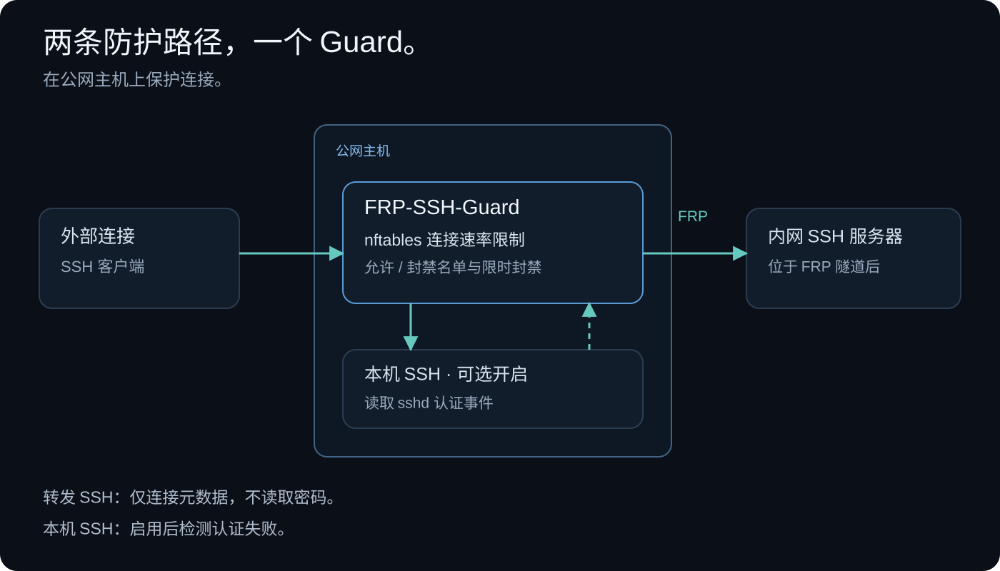

# FRP-SSH-Guard

[English](README.md) | **简体中文**


**[下载 v0.0.7 .deb](https://github.com/xybermindx/FRP-SSH-Guard/releases/download/v0.0.7/frp-ssh-guard_0.0.7.deb)** · [全部发布文件](https://github.com/xybermindx/FRP-SSH-Guard/releases/tag/v0.0.7)

保护 FRP 转发的 SSH 端口，并可选保护公网服务器自身的 SSH 22 端口。
FRP-SSH-Guard 提供 nftables 连接速率限制、本机 SSH 失败检测、共享或按端口独立的
封禁，以及按端口限定或限时的手动黑名单。安装在公网 `frps` 主机上；
配置位于 `~/.frp-ssh-guard/`，升级保留自定义值和正在运行的防护。
本机 SSH 防护和按端口独立封禁默认关闭；慢速暴力破解防护默认开启。

> **约 10 天观测：** 已丢弃 **4,255,592** 个恶意数据包（**99.97%**），
> 对 **595** 个唯一 IP 触发 **1,110** 次自动封禁，最近 24 小时后端登录失败 **0** 次。

**版本 0.0.7 · MIT 开源许可 · Bash 与 Python**

[v0.0.7 更新说明](docs/RELEASE-v0.0.7.md) ·
[配置及命令示例](docs/EXAMPLES.zh-CN.md) ·
[升级说明](docs/MIGRATING.md)（英文）

[部署步骤](#逐步部署) · [配置说明](#配置说明) · [命令](#常用命令) ·
[防护范围](#可以防护哪些攻击) · [验证效果](#验证防护是否生效) · [源码构建](#开源与源码构建)

## 防护路径



转发 SSH 的认证内容保持加密，Guard 仅利用连接元数据进行防护。可选的本机 SSH 防护读取公网主机的 sshd 认证事件；不采集密码。

## 部署观测数据

一位部署者提供了同一生产环境在**约 10 天观测窗口**内的数据，并附有**约 30 天的后端日志窗口**。

| 指标 | 启用前 / 更早（部署者提供） | 启用后（部署者提供） |
| --- | --- | --- |
| 观测窗口 | - | **约 10 天** |
| 自动封禁事件总数 | - | **1,110** |
| 被自动封禁的唯一 IP 数 | - | **595** |
| 每日自动封禁事件 | - | **155 降至 37**（窗口内逐步下降） |
| 防护规则包计数，距上次重载约 5 天 | - | **丢弃 4,255,592；通过 1,287** |
| 上述包计数中的丢弃占比 | - | **99.97%** |
| 24 小时窗口内后端登录失败 | **6,442 次** | **观测到 0 次** |
| 公共防护启用前约 30 天的后端登录失败 | **927,446 次** | - |
| 所有代理连接，按小时 | 约 248 次/小时 | **约 56 次/小时**（24 小时 1,336 次） |
| 24 小时到达后端的 SSH 连接 | 约 200 次以上/小时 | **246 次（约 10 次/小时）** |

相对于提供的基线，所有代理连接约**减少 77%**，到达后端的 SSH 连接约**减少 95%**，
且最近 24 小时窗口内后端**未记录到登录失败**。剩余的所有代理连接主要是
443 端口的公共 Web 流量，该部署有意将其排除在防护范围之外。

包丢弃占比的计算为 `4,255,592 / (4,255,592 + 1,287)`。
它表示所提供计数器中的丢弃比例；已建立连接和白名单流量可能绕过这些计数器。
这个比例不能直接表示独立攻击者数量或攻击识别准确率。
登录失败记录为零表示该 24 小时窗口内未观察到失败事件；成功登录及其他认证活动属于不同指标。

1,110 次封禁事件和 595 个唯一地址是约 10 天观测窗口内的累计值；
包计数器覆盖规则上次重载以来的约 5 天。两者都是原始观测值，并非归一化速率。

这些数据来自部署者提供的现有环境观测；未提供确切部署版本或原始日志供独立核验。
流量、配置和日志覆盖范围都会影响结果。
部署者还报告监控显示 CPU 使用率约为 0%、进程内存为数 MB；
由于未提供测量方法或内核防火墙开销，这些资源观测不构成性能基准测试。

## 项目目的与功能

FRP 可以通过公网服务器暴露内网服务，转发的 SSH 端口也可能受到自动扫描和大量连接尝试。
本项目为明确选择的端口增加主机防火墙策略：

- 按来源 IP、目标端口限制新连接速率，并临时封禁来源。
- 慢速暴力破解防护：对转发端口做长窗口连接数限制，对本机 22 端口做长窗口失败登录限制。
  白名单来源从不计数。
- 可选保护本机 22 端口，并检测本机 sshd 认证失败。
- 默认所有受保护端口共享 IP 封禁，也可切换为每端口独立封禁。
- 对每个端口设置共享速率上限，缓解分布式连接突发。
- 支持 IPv4/IPv6 地址、CIDR 网段以及按端口限定的白名单和黑名单。
- 记录封禁历史，对重复被观察到的违规来源延长封禁时间。
- 自动学习管理员：root、设置所有者或 sudo/admin/wheel 组成员成功登录公网服务器本机 sshd 后，
  其来源会加入白名单。
- 显式应用配置、重启恢复，以及防护表丢失后的恢复。
- 提供架构无关的 Debian 软件包、完整源码和可重复构建流程。

工具观察的是新 TCP SYN 数据包，**无法看到转发 SSH 会话中的密码或登录结果**。
它是身份认证措施的补充，不是入侵检测系统，也不是上游 DDoS 清洗服务。

## 应该部署在哪里


安装在 **运行 `frps` 的公网服务器**，即公网转发端口实际监听的主机。
只安装在内网 `frpc` 主机上，不能保护公网监听端口。
例如公网端口 `22001` 转发到内网机器的 `22` 端口，应在公网服务器上保护 `22001`。

目标环境：

- Debian 12+ 或 Ubuntu 24.04+，使用 systemd、nftables 1.0.6+，且内核支持 nftables。
- 安装和修改防火墙需要 root 权限。
- `frps` 直接在主机网络命名空间监听。容器桥接/NAT 端口映射不属于此 input hook 方案的覆盖范围，需要另行验证。
- 每台主机仅支持一个防护实例。其他防火墙规则仍然有效；本工具不会放行被其他规则阻止的端口。

只过滤明确选择的 TCP 端口。不要选择 FRP 控制端口或公共 Web 端口。
通过 `PROTECT_SERVER_SSH=on` 单独启用本机管理 SSH 22 端口防护，默认 `off`。
其他已选监听端口必须属于 `frps`；验证器无法识别 FRP 隧道中实际运行的应用。

以上是目标平台，不代表所有系统和内核组合都经过测试。
实际验证范围见[验证记录](docs/VALIDATION.md)（英文）。

## 可以防护哪些攻击

| 流量或攻击 | 预期效果与边界 |
| --- | --- |
| 同一来源对受保护端口发起大量新连接 | 超过单来源限制后临时封禁，默认共享所有受保护端口，也可启用按端口封禁。 |
| 不断重新连接的 SSH 暴力破解工具 | 限制连接尝试；可选的本机 sshd 监控还会统计认证失败。 |
| 重复尝试本机不存在的用户名 | 启用 22 端口防护后，默认 10 分钟内 3 个不同连接的无效用户尝试或 5 次认证失败触发封禁。 |
| 分布式连接突发 | 每端口共享上限丢弃过量新连接；正常用户也可能受影响。 |
| 多次被观察到的封禁 | 累犯策略可以延长封禁；采样可能漏掉短期或重复事件。 |
| 已知不需要的 IP 或网段 | 手动黑名单丢弃匹配流量，但白名单和已建立连接的优先规则仍然适用。 |
| 低于每分钟阈值的慢速尝试 | `SSH_SLOW_PROTECTION=on`（默认）时：同一来源 24 小时内在所有转发端口合计超过 300 次新连接（按端口独立封禁时为单端口 100 次），或本机 22 端口 20 次失败登录，即被封禁。计数随时间逐步恢复，因此为近似值。 |
| 转发 SSH 连接内部猜密码 | 无法看到；无法读取转发 SSH 的认证结果，只能统计连接次数。 |
| 应用漏洞利用或被盗凭据 | 不提供应用层识别或阻止能力。 |
| 占满带宽的 DDoS | 不保证服务可用；主机过滤无法恢复已经被占满的上游链路。 |
| 未配置端口、UDP 和其他协议 | 不在过滤范围内。 |

**实际效果取决于流量、配置和部署方式。** 上述观测仅对应单个部署环境。
本项目不宣称通用防御成功率、吞吐性能或外部安全审计结果。
统计对象是新 SYN 包（包括重传），不是精确的会话数量或登录次数。

## 下载发布版本

请从 **[GitHub Releases](https://github.com/xybermindx/FRP-SSH-Guard/releases/tag/v0.0.7)** 下载。Debian `.deb` 文件作为发布附件提供，
不会显示在 GitHub 的 **Packages** 栏目中。v0.0.7 发布版本包含：

| 文件 | 用途 |
| --- | --- |
| [frp-ssh-guard_0.0.7.deb](https://github.com/xybermindx/FRP-SSH-Guard/releases/download/v0.0.7/frp-ssh-guard_0.0.7.deb) | 安装到目标 Debian/Ubuntu 主机。 |
| [SHA256SUMS](https://github.com/xybermindx/FRP-SSH-Guard/releases/download/v0.0.7/SHA256SUMS) | 校验下载的 Debian 软件包。 |

完整源码保留在仓库中。GitHub 会根据发布标签自动提供
[Source code (zip)](https://github.com/xybermindx/FRP-SSH-Guard/archive/refs/tags/v0.0.7.zip)
和 [Source code (tar.gz)](https://github.com/xybermindx/FRP-SSH-Guard/archive/refs/tags/v0.0.7.tar.gz)，
包含运行代码、构建脚本、打包文件、文档及测试。无需再上传重复的源码附件。
`SHA256SUMS` 仅校验 `.deb` 文件。

软件包包含脚本，而非针对特定 CPU 编译的二进制程序。Debian 元数据使用
`Architecture: all`，依赖包按主机架构安装。当前 CI 验证的是 x64（amd64）；
ARM 和 32 位系统尚未验证。
校验和可检测文件变化或损坏，但不是发布者签名。
已在一次性 Debian 12 虚拟机中验证 FRP/systemd 行为。
[CI 工作流](https://github.com/xybermindx/FRP-SSH-Guard/actions/workflows/ci.yml)
检查构建、nftables 和 Debian/Ubuntu 软件包生命周期。
实际验证范围与限制见[验证记录](docs/VALIDATION.md)（英文）。

## 逐步部署

### 1. 启动需要保护的 FRP 监听端口

在公网服务器启动 `frps`，并连接对应的 `frpc` 客户端。例如检查转发端口 `22001`：

```bash
sudo ss -lntp 'sport = :22001'
```

监听进程应显示为 `frps`。验证时至少需要一个已选端口具有活动的 FRP 监听；
允许其他已选端口暂时没有监听，但不允许它们由非 FRP 进程监听。
先确认原来的转发 SSH 服务可以正常使用。
若只保护本机 SSH，可使用 `PROTECT_SERVER_SSH=on` 并留空 FRP 端口选择，
此时验证 22 端口的 sshd/systemd socket 监听。

### 2. 校验并安装软件包

把 `.deb` 和 `SHA256SUMS` 下载到同一目录：

```bash
sha256sum --ignore-missing -c SHA256SUMS
sudo apt install ./frp-ssh-guard_0.0.7.deb
```

确认 `.deb` 显示 `OK`。**升级已运行的守卫会自动应用新版规则和监控，无需手动 reload。**
首次安装或已停用的守卫保持未启用状态，需先配置端口并启用防护。apt 会处理依赖安装。

### 3. 设置公网转发端口

```bash
${EDITOR:-nano} ~/.frp-ssh-guard/settings.conf
```

安装会自动创建该目录，并迁移现有设置和手动名单。
普通的 `sudo apt install ./frp-ssh-guard_0.0.7.deb` 使用调用 sudo 的用户的家目录；
直接由 root 或无人值守安装时使用 `/root/.frp-ssh-guard/`。
后续升级保留已选用户及其自定义值，即使换一位管理员安装也不会更换位置。

从软件包 `0.0.5-2` 开始，安装器会从当前模板补齐缺失的设置及说明注释。
缺失的 `PROTECT_SERVER_SSH=off` 和 `JAIL_PER_PORT=off` 开关会放在
`PROTECTED_PORTS`、`EXCLUDE_PORTS` 的紧下方，位于其他设置之前。
现有赋值和注释保留，包括已经设为 `on` 的开关。修改前会在同一目录保存完整原文件，
命名为 `settings.conf.before-upgrade-*`，权限为 0600。配置完整时重复安装不会修改文件，
也不会产生额外备份。其他缺失默认项追加到末尾；不会用空的 `PROTECTED_PORTS`
覆盖旧式端口文件的选择。

此操作只更新可编辑文件，不改变已接受策略、当前封禁或定时任务触发时间，
也不会应用尚未确认的自定义修改。补齐默认项后，状态可能显示存在待应用修改。
准备启用本机 SSH 防护时，将 `PROTECT_SERVER_SSH=on`，然后明确执行 `check`、`reload`。
若文件不可访问或格式无效，会保留原文件并提示；修复后可用
`sudo apt install --reinstall ./frp-ssh-guard_0.0.7.deb` 重试。

首次迁移前可用
`sudo env FRP_GUARD_CONFIG_USER=USERNAME apt install ./frp-ssh-guard_0.0.7.deb`
指定所有者。若家目录不可用或已有文件冲突，安装器会报告并继续使用原有配置，
不会覆盖数据。用 `frp-ssh-guard --help` 查看实际路径，修复后可执行
`sudo frp-ssh-guard config-home USERNAME` 重试。
迁移保留已接受策略、当前封禁和定时任务触发时间；活动的名单监听器会切换到新目录，
无需重新加载 systemd。

例如保护 `22001`、`22003` 和 `23000–23010`，但排除 `23005`：

```bash
PROTECTED_PORTS="22001,22003,23000-23010"
EXCLUDE_PORTS="23005"
PROTECT_SERVER_SSH=off
JAIL_PER_PORT=off
PER_IP_RATE=2
PER_IP_BURST=40
GLOBAL_RATE=30
GLOBAL_BURST=20
BAN_TIMEOUT=6h
LEARN_ADMINS=on
LOGIN_USERS=""
```

请把示例端口替换成真实的公网 SSH 转发端口。默认文件中的 `PROTECTED_PORTS` 为空，必须明确设置后才能启用。
其他参数可先保留默认值；多人共享 NAT/VPN 出口时可能需要调整阈值。

### 4. 验证并启用

```bash
sudo frp-ssh-guard check
sudo frp-ssh-guard enable
sudo frp-ssh-guard status
```

`check` 仅验证，不启用防护。`enable` 立即应用规则，并开启重启恢复。
请另外建立一个 SSH 连接验证访问；测试期间保留管理会话或控制台入口。

首次部署也可以选择 30 分钟自动到期的试运行：

```bash
sudo frp-ssh-guard trial
# 从另一个连接确认访问正常后，保留防护：
sudo frp-ssh-guard keep
```

在防护未运行且未设置开机恢复时，用 `trial` 代替 `enable`。
试运行不会在重启后恢复；`keep` 会启用持久启动。
试运行期间先执行 `keep` 或 `disable`，再修改策略。

### 5. 后续修改配置

```bash
${EDITOR:-nano} ~/.frp-ssh-guard/settings.conf
sudo frp-ssh-guard check
sudo frp-ssh-guard reload
sudo frp-ssh-guard status
```

仅保存文件不会生效。后台任务、手动名单更新、防护表恢复以及重启都会使用上次成功应用的策略。
`check` 只做验证，不做任何修改。`reload` 在守卫运行时接受并应用修改；首次启用或
`disable` 之后改用 `enable`。之后 `status` 显示 `Pending edits: no`。reload 保留当前封禁
和已学习条目的剩余时间，连接计数重新开始，并刷新监控服务。`whitelist.conf` 和
`blocklist.conf` 不同：保存后自动生效，无需 reload。验证或 nftables 应用失败时，保留原有防护。
服务或辅助任务故障会单独报告；发生此类错误时，规则可能已经生效。

### 启用服务器自身的 SSH 22 端口防护

用 `frp-ssh-guard --help` 查看实际配置路径。在端口选择附近设置
`PROTECT_SERVER_SSH=on`。保留 `JAIL_PER_PORT=off` 可共享封禁，
设为 `on` 则各受保护端口独立封禁。仅保存文件不会生效。防护已运行时执行：

```bash
sudo frp-ssh-guard check && sudo frp-ssh-guard reload
sudo frp-ssh-guard status
```

确认状态显示 `Server SSH protection: on`。首次启用时用 `enable` 代替 `reload`。
该开关会自动加入 22 端口。显式 reload 会重建防火墙及速率计数；
已保存的封禁和学习条目保留原到期时间。软件包升级也会自动刷新规则，
同时保留已保存封禁的截止时间和定时任务安排。

可继续保留 Fail2ban：两者使用各自的规则，封禁相互独立。
如果同一个地址被两者封禁，需要分别解除。本工具不会修改 Fail2ban jail 配置；
学习功能会把可信地址加入现有 Fail2ban sshd jail 的忽略名单。`LEARN_ADMINS=on`（默认）
从 root、设置目录所有者以及 `sudo`、`admin` 或 `wheel` 组成员的成功登录中学习，无需输入用户名。
`LOGIN_USERS` 可按正则表达式添加其他账户；`status` 会显示学习范围。
支持密码、公钥及 keyboard-interactive/PAM 成功认证。学习的 `[all]` 条目覆盖已启用防护的 22 端口，
其他端口分节下的条目不会覆盖 22。已允许的来源仍被拦截时，请另行检查 Fail2ban。

仅 FRP、仅本机 SSH、组合防护的配置见[示例](docs/EXAMPLES.zh-CN.md)。

## 配置说明

完整参数说明见[带注释的默认配置](etc/settings.conf.example)。文件使用字面量
`KEY=value` 赋值，只作为数据解析，不执行 shell 命令或替换表达式。
请保持家目录配置私有，它决定防火墙策略。默认配置注释和命令输出使用英文。

| 参数 | 默认值 | 说明 |
| --- | --- | --- |
| `PROTECTED_PORTS` | 空，必须设置 | 逗号或空格分隔的端口/范围；`22001:60:40` 覆盖该端口的共享速率和突发额度。 |
| `EXCLUDE_PORTS` | 空 | 从保护范围中排除的端口/范围。 |
| `PROTECT_SERVER_SSH` | `off` | `on` 添加本机 22 端口防护，并监控本机 sshd 认证结果。 |
| `JAIL_PER_PORT` | `off` | `off`：新自动封禁共享所有受保护端口；`on`：新封禁仅针对触发端口。现有封禁范围不变。 |
| `SSH_SLOW_PROTECTION` | `on` | 慢速暴力破解开关，位于 `JAIL_PER_PORT` 下方。`on` 检测、记录并封禁；`off` 全部不做。转发端口统计新连接；启用本机 SSH 防护时，22 端口统计失败登录。白名单中任意端口的来源从不计数。 |
| `SSH_AUTH_FAILURES`, `SSH_INVALID_USER_FAILURES`, `SSH_AUTH_WINDOW` | `5`, `3`, `10m` | 本机认证失败阈值、不同连接的无效用户阈值、统计窗口。 |
| `SSH_SLOW_TOTAL_CONNECTIONS`, `SSH_SLOW_PORT_CONNECTIONS`, `SSH_SLOW_FAILURES`, `SSH_SLOW_WINDOW` | `300`, `100`, `20`, `24h` | 慢速限制：同一来源在所有转发端口合计（共享封禁）或单个转发端口（按端口封禁）的新连接数、22 端口失败登录数，以及共用的统计窗口。 |
| `LOG_MAX_SIZE` | `10MiB` | 活动日志大小；最新在前，超限删除最旧完整行；允许 1KiB–100MiB，不保留档案。原名 `ALERT_LOG_MAX_SIZE`。 |
| `SUBNET_REPORT_MIN_SOURCES`, `SUBNET_REPORT_WINDOW` | `5`, `24h` | 按 /24 或 /64 及 jail 范围统计不同自动封禁来源，仅报告，不自动封禁子网。 |
| `PER_IP_RATE`, `PER_IP_BURST` | `2`, `40` | 每来源、每端口的新 SYN 每分钟速率及突发额度。 |
| `GLOBAL_RATE`, `GLOBAL_BURST` | `30`, `20` | 每端口共享的新 SYN 每分钟速率及突发额度，跨来源和 IP 协议族共享。 |
| `BAN_TIMEOUT` | `6h` | 临时封禁来源的时长。 |
| `LEARN_ADMINS` | `on` | root、设置所有者或 `sudo`/`admin`/`wheel` 组成员在本机成功登录后，将来源加入白名单，有效期 `LEARN_TIMEOUT`。共用该公网 IP 的其他人也会被信任。 |
| `LOGIN_USERS` | 空 | 额外可学习信任的账户，扩展正则表达式，例如 `alice|bob`。 |
| `MAX_LEARNED`, `LEARN_TIMEOUT` | `500`, `90d` | 学习来源数量上限，以及距上次可信登录的有效时长。 |
| `STRIKE_WINDOW` | `90d` | 观察到的封禁事件的历史统计窗口。 |
| `STRIKE_LADDER` | `2:1d 3:3d 4:7d 5:28d` | 递增的违规次数及封禁时长；空字符串禁用升级。 |
| `STRIKE_MAX` | `28d` | 升级封禁时长上限；恢复时不延长原到期时间。 |
| `PORT_MIN`, `PORT_MAX` | `1`, `65535` | 端口校验的上下界，包含边界。 |
| `EDIT_USER` | `root` | 拥有命令管理名单的可信本机账户。 |
| `GUARD_TABLE` | `frp_ssh_persistent_guard` | 专用 nftables 表名；修改前先停用防护。 |

修改 `JAIL_PER_PORT` **仅影响新产生的封禁**。无论切换到哪种模式，已有的 `[all]`
封禁仍共享所有受保护端口，已有的按端口封禁仍保留原来的端口范围。
切换不会释放、扩大、缩小或重新计时任何现有封禁。累犯历史保留每次事件记录的范围，
后续定时任务不会把旧的按端口事件重新解释为共享事件。手动范围和白名单例外保持不变。
编辑设置后，运行 `sudo frp-ssh-guard check && sudo frp-ssh-guard reload` 生效。

时长格式为正整数加 `s`、`m`、`h`、`d` 或 `w`（秒、分、小时、天、周）。
速率、突发额度及学习数量上限是 1–1000000 的整数。
突发额度随时间补充，不是每个自然分钟固定允许若干次尝试。
本机成功登录学习会信任来源 IP，也会将其加入现有 fail2ban `sshd` jail 的忽略名单。
它无法学习 FRP 隧道后端 SSH 服务的成功登录。

| 位置 | 用途 |
| --- | --- |
| `~/.frp-ssh-guard/settings.conf` | 安装时自动创建/迁移的可编辑策略。 |
| `~/.frp-ssh-guard/whitelist.conf`, `blocklist.conf` | 安装时自动创建/迁移的手动与自动合并名单。 |
| `/etc/frp-ssh-guard/` | 初始/旧版设置，以及选定的家目录位置记录。 |
| `/var/lib/frp-ssh-guard/applied.conf` | 生成的已接受策略，请勿手动修改。 |
| `/var/lib/frp-ssh-guard/lists/` | root 缓存、迁移元数据和累犯历史；不需要另行编辑。 |
| `/var/log/frp-ssh-guard/` | 封禁与学习历史。 |
| `/usr/lib/frp-ssh-guard/` | 软件包管理的运行程序。 |

手动和自动条目合并保存于 `whitelist.conf` 与 `blocklist.conf`。
文件内包含说明和 `[all]` / 按端口分节，见[名单示例](docs/EXAMPLES.zh-CN.md#合并名单)。
**不写时间的地址永久有效**，写 `IP forever` 效果相同：

```ini
[all]
203.0.113.10                              # 不写时间：永久封禁
203.0.113.11 forever                      # 同上，显式写出
198.51.100.0/24                           # 整个子网，永久
203.0.113.12 tier=2                       # 默认阶梯下为 1 天
203.0.113.15 until=2030-01-31T00:00:00Z   # 到此 UTC 时间为止
[22001]
203.0.113.20                              # 永久，仅限 22001 端口
```

文件中不接受 `7d` 这类直接时长；请使用 `tier=`/`until=`，或
`sudo frp-ssh-guard block IP --for 7d`。黑名单中的 `IP tier=1` 到
`IP tier=5` 选择已配置时长（默认 6h、1d、3d、7d、28d）。自动条目带有 `source=learned`、`source=runtime`
或 `source=strike`，以及绝对 UTC `until=` 到期时间。runtime 包括自动检测和 `ban` 命令。
删除自动行可移除对应信任/封禁；新的攻击或可信登录仍可重新添加。`unban` 还会豁免累犯历史。

防护运行时会监听名单保存；执行 `sudo frp-ssh-guard apply` 可立即应用。
它使用已接受的设置，保留运行中 jail 的到期时间和速率计数。
内核封禁在日志定时任务运行后显示（通常 60 秒内），`blocklist` 命令也会立即刷新。
避免把编辑器中的旧内容覆盖到已有新自动条目的文件上。安装自动导入原有 jail 和旧名单；
旧的内部数据保留用于兼容，不需要分别维护。
由 root 保管的已接受设置及名单缓存使家目录暂时不可用时仍能启动防护。
设置修改仍需执行 `check` 和 `reload`。
防护仍作为系统服务运行，不要求用户登录。目录权限为 0700，文件权限为 0600。
请选择可信管理员：该账户可直接编辑立即生效的手动白名单/黑名单。
字面量解析可防止配置执行任意 shell 命令，但可写策略文件仍意味着可以决定信任或封禁谁。

本机 SSH 监控读取 journald 中由 root sshd 产生的记录，使用无效用户及认证
成功/失败结果，不采集密码，也不保存用户名。成功登录会清除近期失败计数。
SYN 和本机认证封禁使用相同的时长及端口范围设置。
回环、已建立连接和白名单继续优先放行。
无法读取 FRP 后端 SSH 的认证结果；本机监控要求 sshd 日志进入 journald，
针对服务器标准 22 端口。

手动封禁默认为永久，直到执行 `unblock`；使用 `--for` 可指定时长。
默认作用于所有**受保护**端口，显式端口范围不受 jail 模式开关影响：

```bash
sudo frp-ssh-guard block 198.51.100.20 --all
sudo frp-ssh-guard block 203.0.113.8 --ports 22001,22003 --for 6h
sudo frp-ssh-guard unblock 203.0.113.8
```

限时条目保存绝对 UTC `until=` 时间，reload/重启不会延长有效期。
全部端口封禁会随受保护端口的选择变化。
`ban IP [DURATION]` 创建限时 runtime 封禁（默认 `BAN_TIMEOUT`），到期时间保存于同一黑名单。
`block --for` 创建可手动指定端口范围的限时条目。

## 常用命令

```bash
frp-ssh-guard --help                       # 无需 root
frp-ssh-guard --version                    # 查看版本，也可用 version 或 -V
sudo frp-ssh-guard check                    # 验证编辑后的配置
sudo frp-ssh-guard enable                   # 立即应用并开启重启恢复
sudo frp-ssh-guard reload                   # 运行期间接受新配置
sudo frp-ssh-guard status                   # 状态、已接受端口、待应用修改
sudo frp-ssh-guard ports                    # 已接受的端口规格
sudo frp-ssh-guard allow 198.51.100.10       # 在所有受保护端口信任此来源
sudo frp-ssh-guard allow 2001:db8::10 22001  # 只在指定端口信任
sudo frp-ssh-guard block 203.0.113.0/24 22001
sudo frp-ssh-guard banned
sudo frp-ssh-guard strikes
sudo frp-ssh-guard report
sudo frp-ssh-guard release 198.51.100.20     # 移除封禁并豁免历史
sudo frp-ssh-guard disable                  # 停用防护，保留配置和数据
```

以上 IP 是文档示例，不是真实部署数据。
其他管理命令包括 `whitelist`、`blocklist`、`learned`、`unallow`、`unblock`、`unban`、
`ban`、`remember` 和 `forget`，具体参数见 `--help`。
`install`/`remove` 保留为 `enable`/`disable` 的兼容别名。
`apply` 重新应用已接受策略和当前名单；接受配置修改请使用 `reload`。

## 验证防护是否生效

成功启用后应报告防护正在运行、已启用重启恢复。
`status` 应显示 `enabled`、`active`、已接受的端口、无待应用修改，以及试运行状态。
这些是**预期现象**，不是性能测试结果。

在可丢弃的 FRP 测试环境中，按照[验证步骤与记录](docs/VALIDATION.md)（英文）检查：
正常连接、受控突发连接、白名单、解除封禁、未保护服务、显式 reload，以及重启恢复。
该文档还提供有次数上限的连接测试示例。查看计数器和日志：

```bash
sudo nft list table inet frp_ssh_persistent_guard
sudo frp-ssh-guard banned
sudo journalctl -u frp-ssh-guard.service -u frp-ssh-guard-learn.service --since '-10 min'
```

运行边界：

- 共用 NAT/VPN 出口的用户会一起计数；共享端口限制可能在攻击期间影响正常用户。
- 已建立/相关连接和回环流量绕过此防护。白名单优先于黑名单，但不能覆盖其他防火墙表。
- 显式 `reload`、服务重启、系统重启和软件包自动刷新会重建防护表并重置速率计数；已保存的封禁和学习条目保留原到期时间。升级在替换规则前保存当前封禁；突然重启可能丢失尚未采样的封禁。仅更新名单时保留运行中的防护表。
- 可信成功登录会刷新学习条目的到期时间；普通 apply/reload/重启不延长已保存的到期时间。
- 历史每分钟采样一次，可能漏掉短期封禁。防护表丢失的恢复也要等待定时任务，且仅在防护运行期间执行。

## 故障排查

| 现象 | 处理方法 |
| --- | --- |
| 未选择受保护端口 | 设置 `PROTECTED_PORTS`，并确保排除项没有移除全部端口。 |
| 没有已选 FRP 监听 | 启动 `frps` 和对应 `frpc`，检查 `sudo ss -lntp`。 |
| 监听进程不是 FRPS | 确认主机、网络命名空间及公网转发端口。 |
| 配置没有生效 | 先 `check` 再 `reload`，通过 `status` 查看待应用修改。 |
| 正常的高频用户被慢速防护封禁 | 将该地址加入 `whitelist.conf`（任意端口分节），再用 `unban` 解除；白名单来源从不计数。 |
| 管理员连接不稳定、多次尝试后被封禁 | 从其他网络或控制台执行 `sudo frp-ssh-guard release IP`，再执行 `allow IP`。自 `0.0.7-2` 起，成功登录内被拒绝的密钥不计数，掉线连接中被拒绝的密钥每个连接只计一次；`LEARN_ADMINS=on` 时成功登录一次即将该地址加入白名单。 |
| 防护未运行 | 执行 `enable`；`reload` 要求服务处于活动状态。 |
| 配置无效 | 修正错误信息指出的参数；配置损坏时仍可使用 `--help`。 |
| 规则已生效但辅助任务/开机设置失败 | 检查对应 systemd 单元日志，修复后重试 `reload`/`enable`。 |
| 白名单地址仍无法访问 | 检查其他防火墙规则、FRP 转发和后端 SSH 服务。 |

## 升级、迁移与卸载

```bash
sudo apt install ./frp-ssh-guard_NEW_VERSION.deb
frp-ssh-guard --version
sudo frp-ssh-guard status

sudo frp-ssh-guard disable
sudo apt remove frp-ssh-guard  # 保留配置和状态
sudo apt purge frp-ssh-guard   # 删除系统状态和日志；家目录文件保留
```

如果已安装公开版本编号修正前的软件包，请按照
[迁移说明](docs/MIGRATING.md#corrected-public-version-numbering)（英文）
切换到当前版本，并保留现有设置。

下载 **v0.0.7**，执行 `sudo apt install ./frp-ssh-guard_0.0.7.deb` 即可升级较早构建，
并保留原有设置。`frp-ssh-guard --version` 显示发布版本；
`dpkg-query -W frp-ssh-guard` 还会显示 APT 用来识别更新构建的内部软件包修订号。

安装新版 `.deb` 会自动升级程序，保留自定义配置、家目录文件、当前封禁及剩余时长、
服务启用状态和定时任务安排。自定义 systemd 定时设置请放在 `/etc/systemd/system/`
的 drop-in 中，不要修改软件包所有的 `/usr/lib` 单元。Fail2ban jail 配置保持不变。
首次从 v0.0.4 升级时，旧版卸载钩子可能重新计算自定义 `OnActiveSec` 触发时间，
详见[迁移说明](docs/MIGRATING.md)。
从软件包修订 `0.0.6-2` 开始，安装会自动重新编译已接受的防火墙策略，并重启运行中的
Python 监控进程。新版代码在 `apt install` 过程中生效，无需手动 reload 或重启系统。
当前封禁会先保存，再按原作用范围和到期时间恢复。速率计数重置；主服务开机启用状态
和定时任务截止时间保留。尚未确认的设置修改不会被应用。本机 SSH 防护仍需管理员主动开启。
软件包修订 `0.0.7-2` 起默认开启管理员学习（`LEARN_ADMINS=on`），升级的安装也同样开启：
它只增加信任，不会增加封禁。

0.0.7 版用位于 `JAIL_PER_PORT` 下方的 `SSH_SLOW_PROTECTION=on/off` 开关取代
`SSH_SLOW_MODE`。升级不会启用您未选择的封禁：`enforce` 变为 `on`（现在也覆盖转发端口），
`observe`、`off` 或缺失则变为 `off`，安装程序会提示如何开启。`ALERT_LOG_MAX_SIZE`
更名为 `LOG_MAX_SIZE` 并保留原值，`alerts.log` 合并到 `frp-ssh-guard.log`。由于设置文件
有变化，`status` 会显示待应用修改，直到下一次 `check` 和 `reload`。

首次安装或已停用的守卫不会自动启用，正在试用的守卫仍保持临时状态。
管理员的 `policy-rc.d` 限制可推迟刷新并给出提示。刷新失败会由 APT 报告；
防火墙校验或应用失败时保留原规则。

原有 `guard.conf`/`ports.conf` 部署在迁移前仍可使用，
不会被空的新配置文件覆盖。详细操作见[迁移说明](docs/MIGRATING.md)（英文）。
`settings.conf` 由维护脚本保留原有值，补齐缺失的设置及注释，并保存私密备份；完整默认示例仍随软件包文档提供。

## 开源与源码构建

项目所有运行代码均为可阅读的 Bash/Python，并采用 **MIT 许可证**。
仓库和源码压缩包包含打包文件、构建脚本、示例、文档及测试。
没有闭源版本，也不依赖项目提供的在线服务。系统依赖保留各自的许可证。

```bash
# 在解压后的源码目录中，以普通用户执行：
make test
make release  # dist/ 下生成 .deb 和 SHA256SUMS
make dist     # 可选：导出本地源码 tar.gz/zip
```

构建需要 Bash、Python 3、GNU Make 和 `dpkg-deb`。
GitHub 源码下载包含发布标签所对应的仓库文件。可选的 `make dist` 本地导出使用明确的文件清单，
排除真实配置、IP 名单、日志、凭据和原始部署备份。
发布流程见[发布说明](docs/RELEASING.md)（英文）。

如需从源码部署（推荐使用软件包）：

```bash
sudo apt install nftables python3 jq iproute2 util-linux gawk
sudo ./install.sh --ports 22001,22003
# 可选：--exclude 22002 --prefix /opt/my-guard
sudo env GUARD_DIR=/opt/frp-ssh-guard /opt/frp-ssh-guard/bin/frp-ssh-guard status
```

源码安装会激活防护，默认路径是 `/opt/frp-ssh-guard`。
不要同时安装源码版与 Debian 软件包版。重复安装保留设置、单元、定时安排及现有封禁；
策略安装参数只作用于新安装。源码安装及升级在尚未选择家目录所有者时也会自动创建/迁移配置。

## 贡献、安全与许可证

开发和测试参见 [CONTRIBUTING.md](CONTRIBUTING.md)，漏洞报告参见
[SECURITY.md](SECURITY.md)，实现细节参见[架构说明](docs/ARCHITECTURE.md)。
提交示例时使用测试地址，不要提交生产配置或认证日志。

[MIT 许可证](LICENSE)允许使用、修改及再分发，但须保留版权和许可声明。
软件不提供担保，完整条款以许可证文件为准。

## 慢速暴力破解防护与活动日志（v0.0.7）

攻击者常常保持在每分钟阈值以下，全天持续尝试。`SSH_SLOW_PROTECTION=on`
（新安装默认）按各端口可获得的信号封禁它们：

| 端口 | 统计内容 | 默认限制 | 封禁范围 |
| --- | --- | --- | --- |
| 转发端口，`JAIL_PER_PORT=off` | 同一来源在所有转发端口合计的新连接 | 24 小时内超过 300 次 | 所有受保护端口 |
| 转发端口，`JAIL_PER_PORT=on` | 同一来源在单个端口的新连接 | 24 小时内超过 100 次 | 该端口 |
| 本机 22 端口（`PROTECT_SERVER_SSH=on`） | 本机 sshd 日志中的失败登录 | 24 小时内 20 次 | 按 `JAIL_PER_PORT` 的范围 |

frps 服务器无从得知经隧道的登录是否成功，因此转发端口只能统计连接。共享模式下
跨端口合计，可以发现把少量尝试分散到许多端口的攻击者。`whitelist.conf` 中**任意**端口
下的地址（手动或学习所得）都视为已知管理员，从不计数，因为管理员可能每天访问许多
转发主机。`LEARN_ADMINS=on`（默认）时，管理员在本机成功登录一次后其地址即被自动学习；
也可以手动添加。
连接计数在窗口内逐步恢复，因此限制为近似值。封禁使用 `BAN_TIMEOUT` 并计入累犯；
已有黑名单条目保持原范围。设置 `SSH_SLOW_PROTECTION=off` 后执行 `check` 和 `reload`
即可关闭。

`~/.frp-ssh-guard/frp-ssh-guard.log` 每行记录一个事件，最新在前：每次封禁及其原因、
限制和结束时间、手动 `ban` 命令、累犯升级、`unban`/`release`、已接受的设置、新来源的
首次登录以及疑似子网群集。例如：

```text
2026-10-27T09:15:02.000000Z ban source=203.0.113.7 ports=all reason=slow-connections-all-ports limit=300/24h until=2026-10-27T15:15:02Z id=…
2026-10-27T08:02:41.000000Z ban source=198.51.100.9 ports=22 reason=failed-logins limit=5/10m until=2026-10-27T14:02:41Z id=…
```

原因包括 `connection-rate`、`slow-connections`、`slow-connections-all-ports`、
`failed-logins`、`invalid-users` 和 `slow-failed-logins`。内核封禁约每分钟采样一次。
失败登录本身保存在私有存储中，可通过 `report` 查看。达到 `LOG_MAX_SIZE`（默认 10MiB）
时删除最旧的完整行，不留档。

## v0.0.6 本地观察记录

已运行的守卫升级到修订 `0.0.6-2` 后会自动启动新版监控，无需再执行激活命令。
首次启用使用 `enable`。安装会补齐缺失设置，保留自定义值、已接受的策略选择、
待确认修改、已保存封禁的到期时间和定时器截止时间。

短窗口仍为 10 分钟内 5 次失败或 3 个无效用户连接。慢速检测已在 v0.0.7 中重新设计，
见上一节。成功登录清空短窗口失败，长窗口失败按时间自然过期。

活动日志中的新来源登录是复核信号，不代表已被入侵。内容包括 UTC 时间、来源、端口、
原因、适用时的认证方式和计数，不保存账户名、密码或原始日志。修改 `LOG_MAX_SIZE`
后执行 check/reload 可按新上限裁剪；status 和 report 显示上限。这些文件属于本地私密部署数据，请勿提交或分享。家目录不可用时使用
相同上限的私密系统暂存文件，恢复访问后合并。

管理员学习默认开启（`LEARN_ADMINS`），`LOGIN_USERS` 可添加其他账户。密码、公钥及 PAM
成功登录均可在完成来源分类后学习信任。信任针对已观察到的来源 IP，不会自动跟随动态地址；
被盗账户的成功登录也可能建立信任，请保留恢复访问方式。本工具不修改 sshd
认证设置或 Fail2ban 的防火墙规则。

```bash
sudo frp-ssh-guard doctor
sudo frp-ssh-guard report 24h
```

doctor 只读取本机 SSH 规则覆盖、监控状态、journal 访问、白名单覆盖及告警文件
访问情况。report 按事件时间筛选，并区分认证失败、观察阈值、新增自动封禁和
采样丢弃包。包数不是连接数，也不能证明成功防御。现有日志定时器保存包计数增量；
采样区间可能跨越报告边界，崩溃时可能丢失尚未采样的数据。reload 在替换表前保存
旧表计数。新长窗口从明确启用时开始，迁入近期旧短窗口记录但不虚构长期历史。
各观察表上限为 200,000 行，容量导致的数据丢失会在报告中显示。
子网报告按 jail 范围和 IPv4 /24、IPv6 /64 汇总不同自动封禁来源，手动或恢复的
封禁不计入，绝不自动封禁子网。

<sub>An X-project by [XyberMind](http://www.xyber-mind.com/).</sub>
